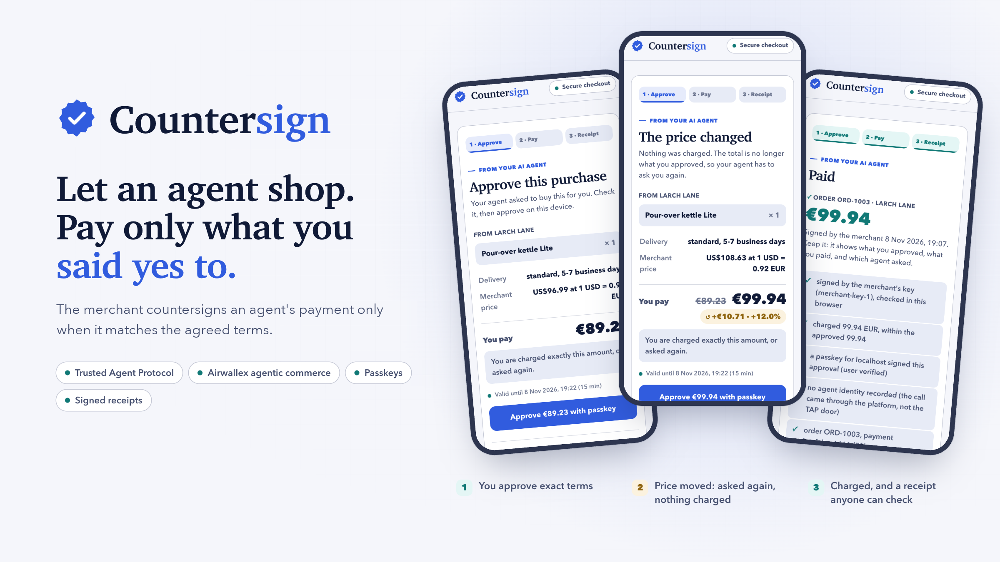
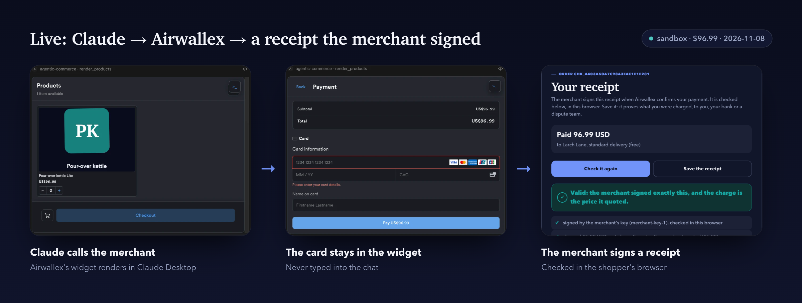
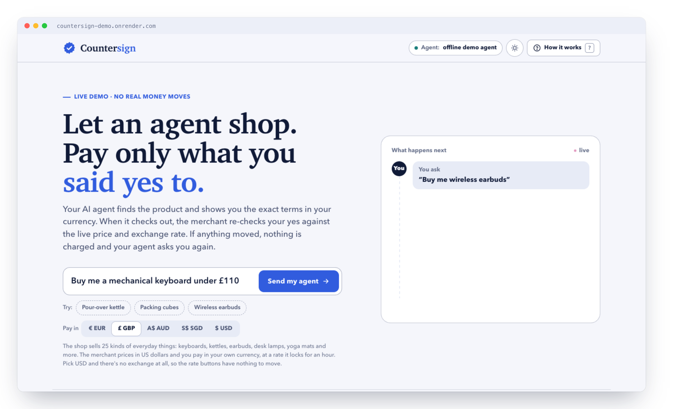
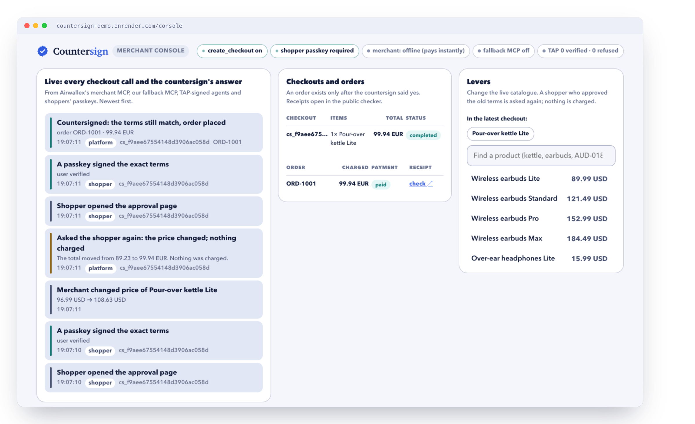
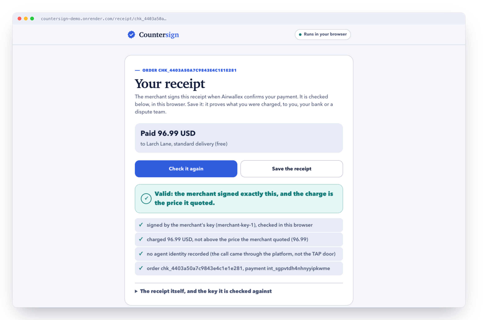
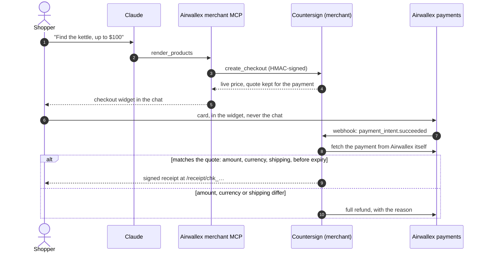
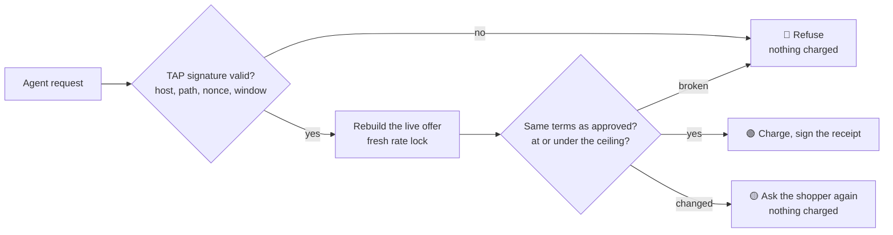

<p align="center">
  <picture>
    <source media="(prefers-color-scheme: dark)" srcset="docs/assets/hero-dark.png">
    
  </picture>
</p>

<h3 align="center">A merchant checkout that keeps an agent's payment only if it matches the agreed terms, and signs a receipt anyone can check offline.</h3>

<p align="center">
  <a href="https://github.com/Aeshvarya/countersign/actions/workflows/ci.yml"></a>
  
  
  <a href="LICENSE"></a>
  <a href="https://countersign-demo.onrender.com"></a>
  
  
</p>

<p align="center">
  <a href="https://countersign-demo.onrender.com"><b>Live demo</b></a> ·
  <a href="#see-it-work"><b>See it work</b></a> ·
  <a href="#how-it-works"><b>How it works</b></a> ·
  <a href="#quickstart"><b>Quickstart</b></a> ·
  <a href="#use-it-from-claude"><b>Use it from Claude</b></a> ·
  <a href="#documentation"><b>Docs</b></a>
</p>

An AI agent can now pay for a person. Between the person's yes and the charge, the price, the exchange rate, the items or the delivery can change, and a bot can replay the same request. Afterwards, if the charge is disputed, the merchant usually cannot show what was agreed.

Countersign is the merchant's side of that purchase, built on Airwallex's agentic commerce for Kit 10 (Merchant-Enabled Agentic Checkout). It does two things:

- **It holds the payment to what was agreed.** On the merchant's own door, it checks the agent's signature and the approved terms before charging, with the ceiling in the shopper's own currency, and asks the shopper again if anything moved. On Airwallex's path, where Airwallex's merchant MCP takes the payment, it checks every payment against the merchant's quote afterwards: a signed receipt if it matches, a full refund with the reason if it does not.
- **It signs a receipt anyone can check.** The terms, the charge and the order number, signed with the merchant's key and verifiable offline. On a real sandbox payment, that receipt went in as the merchant's dispute evidence and Airwallex accepted it; the sandbox simulator was asked to decide for the merchant.

**Built on, and what is ours.** Airwallex provides the hosted merchant MCP, the checkout widget, payments, conversion quotes and disputes. Countersign adds the pricing behind `create_checkout`, the payment-to-quote check, the signed receipts, its own checkout door with TAP and passkeys, and the OAuth server behind the passkey sign-in. Visa's Trusted Agent Protocol is the open format our agent check follows, tested against Visa's reference code; this is not a Visa integration. Google's AP2 has a similar shape (terms hashed, signed by the user on a page the agent does not control, a receipt that carries the hash): our door is AP2-shaped, not an AP2 implementation.

**Team.** Varunika Rai (the merchant's edge: TAP verification, the checkout API and `create_checkout`, the passkey check, onboarding, disputes, the run book) and Aeshvarya Awasthi (the agent, the terms and decision core, receipts, rate locks and payments, settling Airwallex's payments, the OAuth server, the catalogue, the web app, the video).

<br>

## What it does

An AI agent buys something for a person. Countersign is the merchant's side of that purchase: before it charges, the merchant runs two checks, both in code.

| Check | The question | How |
|---|---|---|
| 🪪 **Who is asking** | Is this a known agent, signing for this merchant and this page, right now, once? | [Visa Trusted Agent Protocol](src/countersign/tap.py): an Ed25519 signature bound to the merchant's host and the exact path, with a nonce and a validity window |
| ✍️ **What was approved** | Is this exactly what the shopper said yes to, at or under the price they accepted, in their own currency? | [A hash of the terms](src/countersign/terms.py) the shopper saw, re-checked against the live offer and a fresh rate lock; with passkeys on, [signed by the shopper's passkey](src/countersign/edge/passkey.py) |

Then exactly one outcome, from [one deterministic function](src/countersign/decide.py). No model output reaches it.

<table>
<tr>
<td width="33%" valign="top">

### 🟢 Proceed
Terms unchanged and the price in the shopper's currency at or under the ceiling. The merchant charges and **signs a receipt** anyone can check.

</td>
<td width="33%" valign="top">

### 🟡 Ask again
The price, items, quantity, delivery, merchant or currency changed, the approval expired, or the rate moved past the ceiling. **Nothing is charged**, and the agent shows the shopper the exact change.

</td>
<td width="33%" valign="top">

### 🔴 Refuse
Unsigned, replayed, tampered, inconsistent or on a stale rate lock. **Nothing is charged**, and the reason is logged.

</td>
</tr>
</table>

<br>

## See it work

<p align="center">
  
</p>

That run is real: Claude Desktop on Airwallex's merchant MCP, a sandbox card payment of $96.99, and the merchant's signed receipt checked in the browser. [Open that receipt](https://countersign-demo.onrender.com/receipt/chk_4403a50a7c9843e4c1e1e281) (the host keeps receipts in memory, so a later redeploy clears it).

<table>
<tr>
<td width="50%" valign="top">
<picture>
  <source media="(prefers-color-scheme: dark)" srcset="docs/assets/home-dark.png">
  
</picture>
<p align="center"><b>The demo</b>: send an agent shopping, then move the price, the rate or the stock and watch what the countersign does</p>
</td>
<td width="50%" valign="top">
<picture>
  <source media="(prefers-color-scheme: dark)" srcset="docs/assets/console-dark.png">
  
</picture>
<p align="center"><b>The merchant console</b>: every checkout call and the countersign's answer, live, plus levers that change the catalogue on cue</p>
</td>
</tr>
<tr>
<td colspan="2" valign="top">
<picture>
  <source media="(prefers-color-scheme: dark)" srcset="docs/assets/receipt-dark.png">
  
</picture>
<p align="center"><b>The receipt</b>: what was paid, and every check run in the shopper's own browser. Save it and it still verifies offline, with no server asked</p>
</td>
</tr>
</table>

<br>

## How it works

On Airwallex's path, Airwallex hosts the merchant MCP and takes the payment. Countersign prices every request, keeps the quote, and checks the payment against it before it signs anything.



On the merchant's own door, an agent signs every request with TAP, and the merchant runs the decision before it charges:

1. **The agent proves who it is.** Every request carries a Visa Trusted Agent Protocol signature (Ed25519, bound to the merchant's host and the exact path, with a nonce and a validity window). The merchant's edge refuses unsigned, expired, replayed or misdirected requests before anything else runs. [`tap.py`](src/countersign/tap.py)
2. **The shopper approves exact terms.** Merchant, items, delivery, totals and a ceiling in the shopper's own currency, hashed. [`terms.py`](src/countersign/terms.py)
3. **The merchant countersigns before it charges.** It rebuilds the live offer with a fresh rate lock and runs one deterministic function: proceed, ask again, or refuse. [`decide.py`](src/countersign/decide.py), [`checkout.py`](src/countersign/checkout.py)
4. **The charge happens in the shopper's currency at the locked rate**, through Airwallex Multi-Currency Pricing, and returns the merchant's order number. [`fx.py`](src/countersign/fx.py), [`merchant.py`](src/countersign/merchant.py)
5. **The merchant signs a receipt** binding the agent's identity, the approval's hash and ceiling, the charge and the order number. Anyone with the merchant's public key can check it later, offline. [`receipt.py`](src/countersign/receipt.py)



<br>

## Quickstart

Offline, no keys, in under a minute:

```bash
uv venv && uv pip install -e '.[dev]'
.venv/bin/python -m countersign demo                    # the contrast pairs and a dispute, offline
.venv/bin/uvicorn countersign.web.app:app --port 8000   # the demo app: http://127.0.0.1:8000
.venv/bin/python -m unittest discover -s tests          # 649 tests, offline
```

The app uses Claude when `ANTHROPIC_API_KEY` is set, and a scripted stand-in otherwise (`COUNTERSIGN_MODEL=scripted` forces it). Open `/?q=Buy+me+a+kettle` to start straight away, or `/?s=<session id>` to watch a running session from a second screen.

Check any receipt, offline:

```bash
KEY=$(curl -s https://countersign-demo.onrender.com/.well-known/countersign-merchant-key | python3 -c 'import json,sys; print(json.load(sys.stdin)["public_key"])')
.venv/bin/python -m countersign verify-receipt countersign-receipt-<order>.json --merchant-key "$KEY"
```

Against the Airwallex sandbox (real rate locks, card payments, the catalogue upload, onboarding, disputes) and deploying the public host: [docs/OPERATIONS.md](docs/OPERATIONS.md).

<br>

## Use it from Claude

Add Airwallex's merchant MCP to Claude Desktop (`~/Library/Application Support/Claude/claude_desktop_config.json`):

```json
{
  "mcpServers": {
    "agentic-commerce": {
      "command": "npx",
      "args": ["-y", "mcp-remote@0.16.0", "https://mcp.sandbox.airwallex.com/pa/ai/<merchantId>/acp/mcp"]
    }
  }
}
```

Restart Claude Desktop, sign in with a passkey on the merchant's page, and ask in a new chat:

```text
I'm shopping from the US. Using the merchant, find the Pour-over kettle Lite and price one, with a ceiling of $100. Show me the options. Show me the total and wait for my yes before paying. Keep replies short.
```

Every step, each exception, and our own fallback MCP for Claude Code are in [docs/RUNBOOK.md](docs/RUNBOOK.md).

<br>

## What's live

| | Piece | Proven |
|---|---|---|
| ✅ | **Airwallex's `create_checkout`**: every call prices the cart from the live catalogue with a fresh rate lock, and keeps the quote for the payment | live since 2026-11-04 |
| ✅ | **Payments made in Airwallex's checkout** checked against that quote: a signed receipt, or a full refund if it does not match | live since 2026-11-05 |
| ✅ | **Claude Desktop on Airwallex's merchant MCP**: passkey sign-in on our OAuth server, the checkout widget, the card kept out of the chat | live 2026-11-05 and 2026-11-08 |
| ✅ | **The shopper's receipt page**, handed to the agent as the order's link, settling from Airwallex directly if a webhook is late | live since 2026-11-06 |
| ✅ | **Disputes answered with the receipt**: a chargeback on a real MCP payment, the receipt as evidence, and the sandbox simulator asked to decide for the merchant | live 2026-11-05 and 2026-11-06 |
| ✅ | **The catalogue on Airwallex**: 100 products in Google Merchant Center format, searchable through the merchant MCP | live since 2026-11-04 |
| ✅ | **The countersign on our own door**: TAP, the shopper's passkey on the exact terms (when switched on), ask again on any change | offline, and rehearsed through Claude Code |

Every piece, with what is real and what is simulated: [docs/STATUS.md](docs/STATUS.md).

<br>

## Limits

- **On Airwallex's path the check comes after the payment.** No agent signature and no shopper ceiling reach the merchant, so a payment that does not match the quote is refunded, not prevented. When the session is updated, Airwallex asks for a new quote and the agent gets the new total with no message, so only the agent can ask the shopper again. That is why the re-ask is shown on our own door.
- **A passkey proves a key, not a person.** It shows that a passkey signed the exact terms on the merchant's page, in that session, before they expired. It does not show whose passkey it was. Registering shoppers is the next step, not built. Without passkeys on, the agent sends the ceiling.
- **Our own door charges no card on the live host.** Its merchant there is the offline one (`card_payments: false` at `/healthz`); real card payments run on Airwallex's path.
- **Quotes and receipts live in memory.** A redeploy clears them, and a payment whose quote was lost is left unverified, not refunded.
- **Everything runs on Airwallex's sandbox**, and the disputes were decided by its simulator, at our request.

<br>

## Built to be checked

- **649 tests, all offline.** No network, no keys. CI runs them on every push, plus an [audit](scripts/audit.py) that keeps credentials, real card numbers and dead links out of the repo.
- **TAP interop with Visa's reference code**, checked in both directions by [`scripts/tap_interop.py`](scripts/tap_interop.py).
- **Receipts verify without us.** The merchant's public key is at `/.well-known/countersign-merchant-key`; [`receipt.js`](src/countersign/web/static/receipt.js) checks the signature in the browser, and `verify-receipt` checks it from a terminal.
- **The card never touches this service.** It goes into Airwallex's widget or Drop-in, and the merchant trusts only Airwallex's own record of the payment.
- **Accessible.** Every colour pair passes WCAG AA, light and dark ([`scripts/contrast.py`](scripts/contrast.py)).

<br>

## Documentation

| | |
|---|---|
| [SPEC.md](SPEC.md) | The statement the product is built against |
| [docs/RUNBOOK.md](docs/RUNBOOK.md) | What to type to Claude and what should come back |
| [docs/OPERATIONS.md](docs/OPERATIONS.md) | The Airwallex sandbox, routes, settings and deploy |
| [docs/STATUS.md](docs/STATUS.md) | Every piece and its state |
| [docs/VIDEO_RUN.md](docs/VIDEO_RUN.md) | The video, shot by shot |
| [PROGRESS.md](PROGRESS.md) · [WORKPLAN.md](WORKPLAN.md) | Where the work stands, who does what |

<details>
<summary><b>Project layout</b></summary>

<br>

| Path | What |
|---|---|
| `src/countersign/terms.py` | C1 terms, approval, canonical hash |
| `src/countersign/tap.py` | C2 TAP sign and verify, key directory, nonce cache |
| `src/countersign/merchant.py` | C3 merchant interface, synthetic catalog, offline merchant |
| `src/countersign/fx.py` | C4 rate locks: Airwallex conversion quotes, offline fake |
| `src/countersign/decide.py` | C5 the decision |
| `src/countersign/checkout.py` | C6 the countersign step |
| `src/countersign/receipt.py` | C8 the countersigned receipt |
| `src/countersign/agent/` | the shopping agent: tool loop, approval pause, TAP-signed shop clients |
| `src/countersign/web/` | the demo app; `web/host.py` makes it the one public host (house merchant, `/acp`, catalogue pages, TAP door); `web/merchant_mcp.py` is our fallback merchant MCP over `/acp` |
| `src/countersign/web/shopper.py`, `web/static/shopper.*` | the shopper's page: passkey approval, Drop-in payment, the receipt |
| `src/countersign/web/static/receipt.js`, `web/static/verify.*` | receipt checks in the browser (C8, C13), and `/verify` |
| `src/countersign/web/console.py`, `web/levers.py`, `web/static/console.*` | A15 the merchant console and its live feed; V6 the levers |
| `src/countersign/web/public.py` | the host's public routes: health check, receipt key, the pages and their APIs |
| `src/countersign/payments.py` | the card payment: Airwallex intent, Drop-in handoff, server-side check |
| `src/countersign/airwallex_merchant.py` | V5′ the merchant on Airwallex: pending orders, confirm from Airwallex's own record, refund on mismatch |
| `src/countersign/edge/` | the merchant's HTTP API behind the TAP check, plus the public product pages (`edge/pages.py`) |
| `src/countersign/edge/static/tokens.css`, `edge/tokens.py` | V8 the colour tokens, light and dark, and their reader |
| `src/countersign/edge/acp.py` | C10 the checkout API: Airwallex's `create_checkout` (a fresh quote per call, kept for the payment webhook), and our ACP sessions, where complete runs the countersign and REASK messages |
| `src/countersign/edge/passkey.py` | U1 the shopper's passkey: the approval challenge and the six-check WebAuthn verifier |
| `src/countersign/edge/hmac_auth.py`, `edge/idempotency.py` | the platform HMAC check (one scheme by config) and ACP idempotency rules |
| `src/countersign/catalog_gmc.py` | C11 the catalogue as GMC rows, chunking that keeps a product's variants together, the upload |
| `src/countersign/airwallex.py` | Airwallex REST client |
| `src/countersign/settle.py` | W3 the payments Airwallex's MCP makes, checked against our quote: receipt or refund |
| `src/countersign/web/oauth.py` | C14 the OAuth server Airwallex's MCP signs shoppers in through |
| `src/countersign/disputes.py` | U3 a sandbox dispute: open, upload the receipt as a PDF, challenge, resolve |
| `scripts/payment_spike.py` | real rate lock + real payment on the Airwallex sandbox, in one command |
| `scripts/tap_interop.py` | interop check against Visa's TAP reference code |
| `scripts/upload_catalog.py` | upload the catalogue to Airwallex (dry run without keys) |
| `scripts/ac_onboard.py` | onboarding probe, host check (with our OAuth server), the one-time Kit 10 onboarding and `--update` |
| `scripts/smoke.py` | checks every door of the deployed host; `--buy` runs one purchase end to end |
| `scripts/contrast.py` | V8 WCAG AA contrast of every colour pair the pages use, light and dark |
| `scripts/change_event.py` | V6 from a terminal: price, stock, delivery or reset on the running host, through its lever routes |
| `scripts/dispute_demo.py` | U3 the dispute ending, step by step, stopping if the receipt does not verify |
| `scripts/mcp_token.py` | an Airwallex login token, straight into the shell; not used on the Claude Desktop path |
| `scripts/screens.py` | every screen as a picture, desktop and phone, light and dark |
| `scripts/audit.py` | the audit before the repo goes public (A10), also run in CI |

</details>

<br>

## Licence

[Apache 2.0](LICENSE).
